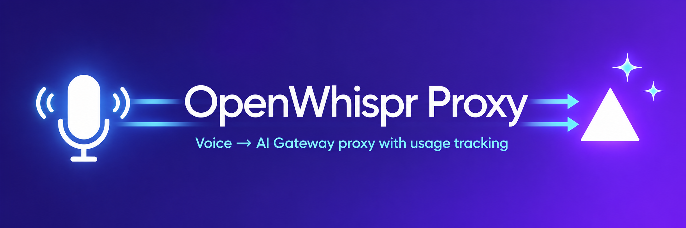

<p align="center">
  
</p>

# OpenWhispr Proxy

[OpenWhispr](https://github.com/OpenWhispr/openwhispr) can use Vercel AI Gateway's text models through its OpenAI-compatible endpoint, but its audio transcription requests do not match the Gateway's audio API. This proxy bridges that gap so OpenWhispr can use Gateway models for transcription. It also routes transcript cleanup through the Gateway and records token usage, cost, latency and audio duration in SQLite. The dashboard shows request history, spending and speaking activity.

Built with TypeScript, NestJS and React. The backend serves the API and dashboard from a single process, with Docker Compose available for local deployment.

## Getting started

### Docker run with the published image

Run the published image directly with Docker. No repository clone or Compose
file is needed:

```bash
docker run -d \
  --name openwhispr-proxy \
  --restart unless-stopped \
  -p 127.0.0.1:8080:8080 \
  -e PORT=8080 \
  -e USAGE_DB_PATH=/app/data/usage.db \
  -v openwhispr-proxy-data:/app/data \
  --label dev.orbstack.icon=https://raw.githubusercontent.com/cmglezpdev/openwhispr-proxy/main/assets/orbstack-icon.png \
  ghcr.io/cmglezpdev/openwhispr-proxy:latest
```

Docker downloads the image if it is missing and creates the named volume
`openwhispr-proxy-data` to preserve usage data when the container is replaced.
Open [the dashboard](http://localhost:8080/dashboard), then
[connect OpenWhispr](#connect-openwhispr). The port is accessible only on the Docker
host. No server-side API key is needed.

To use another host port, change the mapping, for example, to
`-p 127.0.0.1:9090:8080`.

Stop and start the container with `docker stop openwhispr-proxy` and
`docker start openwhispr-proxy`. To update, pull the image, remove the container,
then repeat the `docker run` command above with the same volume name:

```bash
docker pull ghcr.io/cmglezpdev/openwhispr-proxy:latest
docker stop openwhispr-proxy
docker rm openwhispr-proxy
```

The named volume remains after `docker rm`. It is separate from the `./data`
bind mount used by the Compose examples below.

### Docker Compose with the published image

Requires Docker Compose. Download the Compose file and start the published
image from GitHub Container Registry. No repository clone or local build is needed:

```bash
mkdir openwhispr-proxy
cd openwhispr-proxy
curl -fsSLO https://raw.githubusercontent.com/cmglezpdev/openwhispr-proxy/main/docker-compose.ghcr.yml
docker compose -f docker-compose.ghcr.yml up -d
```

The image supports `linux/amd64` and `linux/arm64`, including Apple Silicon.

The proxy is available at `http://localhost:8080`. Compose publishes the port on `127.0.0.1`, so access is limited to the Docker host. Open [the dashboard](http://localhost:8080/dashboard) to view usage, then [connect OpenWhispr](#connect-openwhispr) to start recording activity.

Usage data is stored in `./data/usage.db` on the host. The Compose bind mount preserves it when the container is recreated. To stop the application:

```bash
docker compose -f docker-compose.ghcr.yml down
```

To update to the current image for your selected tag:

```bash
docker compose -f docker-compose.ghcr.yml pull
docker compose -f docker-compose.ghcr.yml up -d
```

### Docker Compose with a local build

To build from source, clone the repository and use the original Compose file:

```bash
git clone https://github.com/cmglezpdev/openwhispr-proxy.git
cd openwhispr-proxy
cp .env.example .env
docker compose up -d --build
```

Both Compose files use the same port settings and persistent `./data` directory.
Use one at a time. Stop the local build with `docker compose down`.

### Without Docker

Requires Node.js 24 or later and pnpm 11. From the repository root:

```bash
pnpm install
cp .env.example .env
pnpm build
pnpm start:prod
```

`pnpm build` compiles both the backend and dashboard. The server uses port `8080` by default.

## Connect OpenWhispr

Configure both the transcription provider and the language model provider in OpenWhispr to use a custom endpoint:

| Setting  | Transcription                 | Transcript cleanup              |
| -------- | ----------------------------- | ------------------------------- |
| Endpoint | `http://localhost:8080`       | `http://localhost:8080`         |
| API key  | Your Vercel AI Gateway key    | The same Gateway key            |
| Model    | A Gateway transcription model | A Gateway text generation model |

Model IDs must include the provider prefix, such as `openai/gpt-4o-mini-transcribe`. Choose a model supported by the Gateway for each operation.

The client sends its Gateway key in the `Authorization: Bearer <key>` header on each request. The proxy creates a Gateway instance with that key for the request. No server-side API key configuration is needed. The included Compose setup expects OpenWhispr to run on the same machine.

## Dashboard

The dashboard at `/dashboard` lets you:

- Search and filter request history by date, operation, model, cost, audio duration and latency.
- Inspect individual requests, including their text and recorded usage.
- Track requests, spend and audio duration through summaries, trends, model comparisons and a daily activity calendar.
- View transcribed word counts, speaking rate and daily transcription streaks.

Table and chart filters start linked and can be adjusted independently. Sorting and pagination affect the table only. The page loads history when opened; reload it to include new requests.

Totals use recorded values and show data coverage when values are missing. Dates use the browser's time zone. See the [dashboard README](dashboard/README.md) for development instructions and metric rules.


## Configuration

The application loads `.env` from the repository root. Both settings are optional.

| Variable        | Default           | Purpose                                                                                                         |
| --------------- | ----------------- | --------------------------------------------------------------------------------------------------------------- |
| `PORT`          | `8080`            | HTTP server port. Compose uses it for both the host and container ports.                                        |
| `USAGE_DB_PATH` | `./data/usage.db` | SQLite database path, relative to the working directory by default. Use an absolute path for a custom location. |

When using Compose, keep the database inside `/app/data` to use the included persistent mount. A different container directory needs its own volume mapping.

## API and storage

| Method | Path                      | Purpose                                                      |
| ------ | ------------------------- | ------------------------------------------------------------ |
| `POST` | `/audio/transcriptions`   | Transcribe an uploaded audio file using the requested model. |
| `POST` | `/v1/chat/completions`    | Generate text for transcript cleanup.                        |
| `GET`  | `/models`                 | Fetch the available Gateway model catalog.                   |
| `GET`  | `/dashboard`              | Serve the dashboard.                                         |
| `GET`  | `/dashboard/api/requests` | Read the saved transcription and cleanup history.            |

The three proxy endpoints require a Gateway key. Dashboard routes do not require authentication.

Audio uploads accept one file up to 100 MiB, plus at most 16 text fields of up to 1 MiB each. Oversized files return `413`; extra files or fields and oversized text fields return `400`. These limits apply before the Gateway call. Provider-specific audio limits still apply.

Completed transcription and cleanup calls are stored in the `transcriptions` and `enhanced_transcriptions` tables. Records include text, model, timestamp, latency, cost and Gateway generation ID when available. Transcriptions also include audio duration. Failed requests and dashboard reads do not create usage records.

Incoming-request summaries in the console contain metadata, without message text, API keys or uploaded filenames. Full result text remains in SQLite for inspection in the dashboard. Docker builds exclude local environment files, usage data and Git history from their context.

The database and its parent directory are created on startup. No separate database service is required.

## Development

Install dependencies and copy `.env.example` as described above. Run the backend and frontend in separate terminals from the repository root:

```bash
# Backend with automatic restart
pnpm start:dev
```

```bash
# Dashboard with live updates
pnpm dev:dashboard
```

Open the frontend URL printed in the terminal at `/dashboard/`. The development server forwards dashboard API requests to the backend using `PORT` from the environment or root `.env`.

| Directory                               | Responsibility                                                                    |
| --------------------------------------- | --------------------------------------------------------------------------------- |
| `src/audio/`, `src/chat/`, `src/model/` | HTTP handlers and application flows for transcription, cleanup and model listing. |
| `src/ai/application/`                   | Provider contracts and generation results used by the application.                |
| `src/ai/infrastructure/`                | Vercel SDK adapter and validation of provider metadata.                           |
| `src/usage/`                            | Usage recording/history contracts and the SQLite implementation.                  |
| `src/dashboard/`                        | Dashboard HTTP endpoints.                                                         |
| `src/config/`                           | Backend configuration.                                                            |
| `dashboard/`                            | Dashboard UI, browser-side analytics and frontend tests.                          |
| `test/`                                 | Backend HTTP integration tests and test setup.                                    |

Application flows depend on `AiProvider` and `UsageRecorder`, not the Vercel SDK or SQLite implementation. `AppModule` binds those contracts to the adapters. The chat adapter retains the upstream response body through the AI SDK, while the application records normalized usage and returns that body unchanged.

HTTP request types live next to the HTTP handlers. Application contracts, usage records and shared dashboard props have named types in their respective modules. SDK metadata is checked when it enters the application. Keep types inferred for local values; add a named type when a contract is shared or an external value needs validation.

### Checks

```bash
pnpm test:all
pnpm lint:dashboard
pnpm build
```

`pnpm test:all` runs backend unit tests, HTTP integration tests and dashboard tests. The HTTP suite builds the frontend and checks that Nest serves its HTML and assets. Jest tests mock Gateway calls and use temporary databases.

For individual suites, use `pnpm test`, `pnpm test:e2e` or `pnpm test:dashboard`.

## Security and local use

This proxy is intended for one user's local workflow. The dashboard has no
authentication, and anyone who can reach it can read saved transcripts and usage
history. Do not run it on a shared or internet-accessible server, or expose it
through a tunnel. Docker Compose binds the port to localhost. When running with
Node.js, the server listens on all network interfaces by default, so use it only
on a trusted machine and network.
